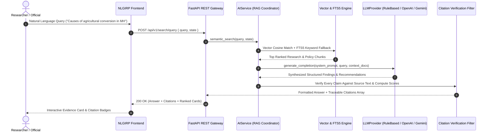

# AI Architecture & RAG Pipeline Specification

## 1. RAG Discovery Pipeline



## 2. LLM Provider Abstraction
The system implements a pluggable `LLMProvider` interface:
```python
class LLMProvider(ABC):
    @abstractmethod
    def generate_completion(self, system_prompt: str, user_prompt: str, context_docs: List[Dict[str, Any]]) -> Dict[str, Any]:
        pass
```
Supported implementations:
1. `RuleBasedEvidenceProvider`: Local deterministic extraction engine guaranteeing **zero hallucinations** by synthesizing strictly from retrieved chunks without requiring external API keys.
2. `OpenAIProvider`: Connects to GPT-4o / GPT-3.5-Turbo via `OPENAI_API_KEY`.
3. `GeminiProvider`: Connects to Gemini 1.5 Pro / Flash via Google AI Studio API.
4. `LocalLLMProvider`: Interfaces with local HuggingFace / ONNX / Ollama models.

## 3. Strict Evidence Attribution & Anti-Hallucination Guardrails
- Generated findings MUST cite the reference index (e.g. `[1]`, `[2]`).
- Source organizations, author institutions, publication year, and document IDs are attached to all output objects.
- All outputs display the prominent disclaimer: *"Demonstration Data — Not Official Government Statistics"*.
