# System Architecture Document

## National Digital Platform for Research, Policy Innovation, and Evidence-Based Land Governance (NLGIRP)

```mermaid
graph TD
    subgraph ClientLayer [Client & User Layer]
        Public[Public User]
        Researcher[Researcher / Academic]
        Official[Government Official / Collector]
        Admin[Super Admin / Policy Analyst]
    end

    subgraph PresentationLayer [Presentation Layer]
        SPA[Single Page Application - Vanilla JS & HTML5]
        DesignSystem[Government-Grade Design System CSS]
        GIS_Viewer[Geospatial Viewer & LULC Analyzer]
        Knowledge_Graph[Interactive Knowledge Graph Canvas]
    end

    subgraph GatewayLayer [Gateway & Security]
        ReverseProxy[Nginx Reverse Proxy / SSL Termination]
        AuthRBAC[Role-Based Access Control - 8 Roles]
        AuditEngine[Immutable Audit Logger]
    end

    subgraph ServiceLayer [Application Services]
        AIService[AI Service - RAG & Citations]
        GISService[GIS Spatial Service - LULC 2015 vs 2025]
        SimEngine[Policy Simulation Engine]
        RecEngine[Recommendation & Trends Engine]
        ReportEngine[Policy Brief Report Generator]
    end

    subgraph DataStorageLayer [Persistence & Vector Layer]
        PostgreSQL[(PostgreSQL 16 + PostGIS 3.4)]
        PgVector[(pgvector 384-d Embeddings)]
        SQLiteFTS[(SQLite3 + FTS5 Full-Text Index)]
        RedisCache[(Redis Distributed Cache)]
    end

    ClientLayer --> PresentationLayer
    PresentationLayer --> GatewayLayer
    GatewayLayer --> ServiceLayer
    ServiceLayer --> DataStorageLayer
```

## 1. Architectural Highlights
- **High-Performance Hybrid Persistence**: Operates with zero external network dependencies on high-speed SQLite FTS5 out of the box, with full enterprise migrations to PostgreSQL 16 + PostGIS + pgvector.
- **Strict Anti-Hallucination Evidence Layer**: The RAG pipeline requires citation verification for every synthesized sentence, attaching primary source documents, author institutions, publication years, and verification scores.
- **Parametric Policy Simulation Sandbox**: Provides multi-dimensional forecasting across economic, environmental, land-use, and dispute metrics, coupled with transparent scientific disclaimers.
- **Multi-Temporal Satellite LULC Integration**: Enables decadal comparisons (2015 vs 2025) of agricultural land conversion, urban sprawl, and forest canopy shifts.
