# GIS & Geospatial Land Intelligence Architecture

## 1. Geospatial Overview
The GIS subsystem enables multi-layered spatial visualization, decadal land-use change detection, corridor buffer queries, and cadastral parcel inspection.

```mermaid
graph LR
    subgraph DataSources [Geospatial Data Sources]
        ISRO[ISRO Bhuvan / NRSC 50K LULC]
        FSI[Forest Survey of India Canopy]
        ULPIN[Bhu-Aadhaar Cadastral Vectors]
        DST[DST Climate Vulnerability Grid]
    end

    subgraph ProcessingPipeline [Spatial Processing & Analytics]
        PostGIS[(PostGIS Spatial DB)]
        GeoJSON[GeoJSON Vector Service]
        LULC_Change[Multi-Temporal LULC Delta Engine]
        Measurement[Geodesic Distance & Area Calculator]
    end

    subgraph ClientGIS [Frontend GIS Explorer]
        Layers[Layer Control: Boundaries, LULC, Corridors, Disputes]
        Timeline[Timeline Slider: 2015 to 2025]
        CompareModal[Dual-Year Split Comparison]
    end

    DataSources --> ProcessingPipeline
    ProcessingPipeline --> ClientGIS
```

## 2. Supported Spatial Layers
1. **Administrative & State Boundaries**: Geodetic polygons with cadastral coverage attributes.
2. **Multi-Temporal LULC**: Cropland, Forest canopy, Urban built-up, Waterbodies, and Wastelands.
3. **Infrastructure Corridors**: DMIC, Expressway right-of-way buffers, and high-speed rail spines.
4. **Climate & Environmental Hazards**: Composite vulnerability index heatmaps (Flood, Drought, Heat).
5. **Judicial Land Dispute Hotspots**: Civil court litigation density per district.
6. **Bhu-Aadhaar Parcels**: 14-digit geo-referenced cadastral parcel boundary samples.

## 3. Land-Use Change Detection Algorithm
Computes transition matrices between two baseline years ($t_1 = 2015, t_2 = 2025$):
$$\Delta A_{crop} = A_{crop}(t_2) - A_{crop}(t_1)$$
$$\Delta U_{built} = U_{built}(t_2) - U_{built}(t_1)$$
Converts spatial percentage differentials to ground hectares based on total jurisdictional area, generating structured natural language interpretations for policymakers.
